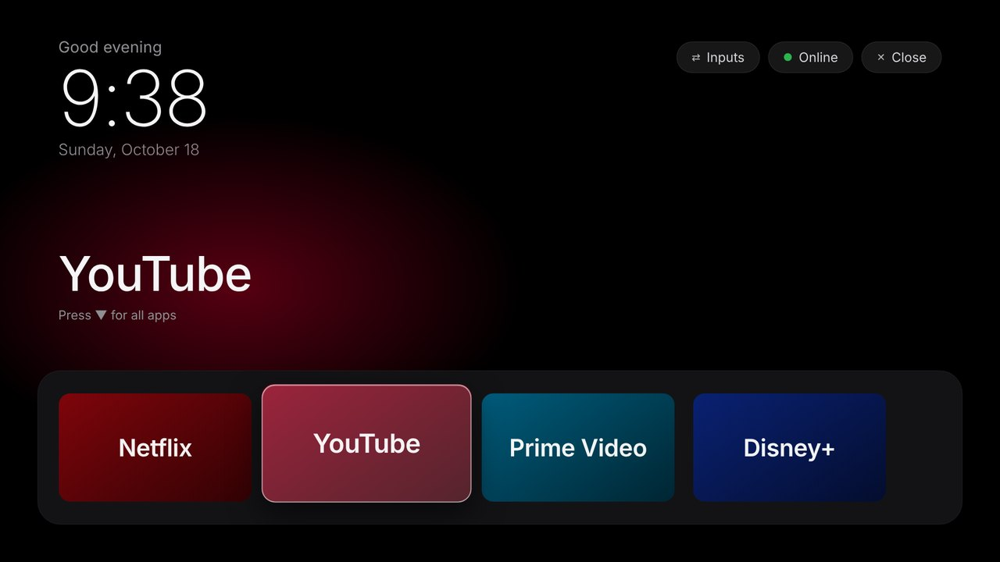
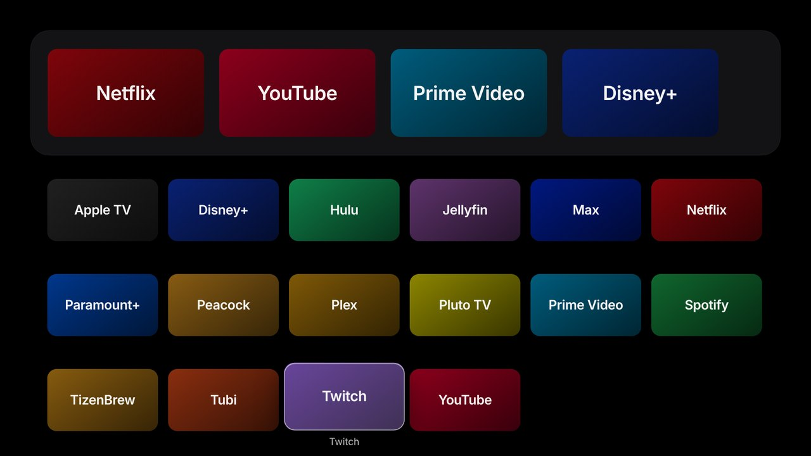

# tizen-vibehack

**A cleaner Samsung TV, as far as Tizen allows.** A tvOS-inspired launcher app, ad-free
YouTube, and network-level ad blocking for Samsung Tizen TVs. Inspired by
[tv-vibehack](https://github.com/Gathin23/tv-vibehack), which does the same for Android TV.

| Home | All apps |
|---|---|
|  |  |

Written for a 2018 **UN55NU6900** (Tizen 4.0); screenshots are the desktop demo mode.
Should work on most 2017–2020 Samsung sets. Newer firmware has been reported to block
sideloading, so YMMV, and please open an issue with your model if it works or doesn't.

## What's possible on Samsung (and what isn't)

Samsung TVs run Tizen, not Android, so there's no ADB and no way to disable system apps
or replace the real home screen without rooting the TV. This repo doesn't root anything.
Instead it stacks three things that get you most of the way:

| Piece | What it does | Needs Developer Mode? |
|---|---|---|
| [`launcher/`](launcher/) **VibeHome** | Your own home screen app: dock, all-apps grid, inputs menu, clock, optional mascots | Yes, once to install |
| **TizenBrew + TizenTube** | Ad-free YouTube with SponsorBlock | Yes, once to install |
| [`blocklist/`](blocklist/) | Pi-hole / AdGuard lists that kill Samsung's ad and viewing-data servers | No |
| [`docs/SETTINGS.md`](docs/SETTINGS.md) | Menu settings: tracking off, auto-open VibeHome at power-on | No |

Everything is reversible: VibeHome is a normal app you can uninstall, and nothing on the
TV's system is changed.

## Quick start (with an AI coding assistant)

Open Claude Code (or any coding assistant) in this folder and paste the prompt from
[`PROMPT.md`](PROMPT.md). It walks you through each step and checks the TV as it goes.

## Quick start (by hand)

### One-time setup

1. **Developer Mode on the TV:** see [`docs/SETTINGS.md`](docs/SETTINGS.md#developer-mode-needed-only-to-installupdate-vibehome).
   Set Host PC IP to your computer's IP, then fully restart the TV.
2. **Tizen Studio** from [developer.samsung.com](https://developer.samsung.com/smarttv/develop/getting-started/setting-up-sdk/installing-tv-sdk.html).
   In its Package Manager → Extension SDK, install **TV Extensions** and
   **Samsung Certificate Extension**.
3. **Connect:** `~/tizen-studio/tools/sdb connect <TV_IP>:26101`
4. **Certificate:** Tizen Studio → Tools → Certificate Manager → **+** → **Samsung** → TV.
   Name the profile `vibehack`, sign in with a Samsung account when asked, choose
   privilege level **Public**, and make sure your TV's DUID is in the distributor
   certificate (it's filled in automatically while the TV is connected).

### Install VibeHome

```bash
# 1. Pick your dock apps and hidden apps
$EDITOR launcher/js/config.js

# 2. Build, sign, install, launch
TV_HOST=192.168.1.50 tools/build-and-install.sh
```

Then pin VibeHome first in the Smart Hub row and turn on **Autorun Last App**
([`docs/SETTINGS.md`](docs/SETTINGS.md)).

Windows: run the script from WSL or Git Bash and set `TIZEN=…/tizen.bat` and
`SDB=…/sdb.exe`.

### Ad-free YouTube

Install [TizenBrew](https://github.com/reisxd/TizenBrew) by following its guide. TizenTube
comes preinstalled inside it. Then put `"TizenBrew"` in your dock instead of `"YouTube"`
in `launcher/js/config.js`.

### Block Samsung's ad servers

Add [`blocklist/samsung-ads.txt`](blocklist/samsung-ads.txt) to Pi-hole or AdGuard Home
(as an adlist URL or pasted into the custom list). Only try
[`samsung-aggressive.txt`](blocklist/samsung-aggressive.txt) after reading its warnings:
it breaks the Samsung app store and can block firmware updates.

## The launcher

VibeHome (`VbHackTV01.VibeHome`) is a Tizen web app written for the 2018 web engine:

- Pitch-black background, a big thin clock, date and greeting top left.
- A dock band with up to six apps. The focused app's name shows above it in large type,
  over a glow tinted to that app's colour.
- Press **Down** and the dock slides up to reveal every app in a grid.
- One glass highlight springs from tile to tile; the focused tile lifts and shows its name.
- Pills top right: **Inputs** (HDMI/AV/Live TV), network status, and **Close**.
- Lists your real installed apps and icons from the TV; apps are matched by name, so
  `config.js` survives firmware changes.

### Mascots

Want a couple of buddies sitting on the dock? Drop transparent PNGs named `1.png` and
`2.png` into `launcher/img/mascots/` and rebuild. They bob gently and hop whenever you move
between dock apps. That folder is git-ignored, so pictures you add stay on your machine
and TV and never get pushed to GitHub. Images with a real transparent background look
best; ones with a baked-in checkerboard will show the checkerboard.

### Desktop preview

Open `launcher/index.html` in a browser. Without the TV's `tizen` API it runs in demo
mode with sample apps; use the arrow keys, Enter and Esc.

## Remote control from your computer

`tools/tv.py` uses the TV's built-in remote API (no Developer Mode needed):

```bash
python3 -m venv tools/venv && tools/venv/bin/pip install -r tools/requirements.txt
export TV_HOST=192.168.1.50
tools/venv/bin/python tools/tv.py probe     # model, firmware, developer mode status
tools/venv/bin/python tools/tv.py apps      # installed app names, for config.js
tools/venv/bin/python tools/tv.py home      # open VibeHome
tools/venv/bin/python tools/tv.py watch     # auto-open VibeHome every time the TV turns on
```

The first command shows an **Allow** prompt on the TV; accept it once.

## Gotchas

- **`sdb connect` fails:** Developer Mode's Host PC IP must be *this* computer's current IP,
  and the TV must be fully restarted after setting it (hold power until the logo).
- **Install fails with a certificate error:** use a **Samsung** certificate (not Tizen),
  privilege level Public, with your TV's DUID included.
- **Install fails with a privilege error:** delete the `tv.window` line in
  `launcher/config.xml`. The Inputs pill then tells you to press SOURCE instead of switching
  inputs itself.
- **Inputs switching is best-effort.** It uses Samsung's TV Window API, which behaves
  differently across firmware. If it doesn't switch, SOURCE on the remote always works.
- **VibeHome can't be the system home screen.** Tizen doesn't allow it. The HOME button
  still opens Samsung's Smart Hub. Autorun Last App plus `tv.py watch` covers power-on.
- **The launcher vanished after a firmware update:** re-enable Developer Mode and rerun
  `build-and-install.sh`.
- **Old web engine:** 2018 sets run a Chromium 56-era engine. The launcher is ES5 with no
  CSS grid, flex `gap` or `backdrop-filter`. Keep it that way if you edit it.

## Repo layout

| Path | What it is |
|---|---|
| [`PROMPT.md`](PROMPT.md) | Prompt for a coding assistant to do the whole setup with you |
| [`launcher/`](launcher/) | VibeHome. `js/config.js` is the file you edit |
| [`tools/build-and-install.sh`](tools/build-and-install.sh) | Build → sign → install → launch (or `uninstall`) |
| [`tools/tv.py`](tools/tv.py) | Remote control, app listing, auto-open on power-on |
| [`blocklist/`](blocklist/) | Pi-hole / AdGuard lists, safe and aggressive |
| [`docs/SETTINGS.md`](docs/SETTINGS.md) | TV menu checklist |

## Licence

MIT, see [`LICENSE`](LICENSE). TizenBrew and TizenTube are separate projects under their
own licences.
